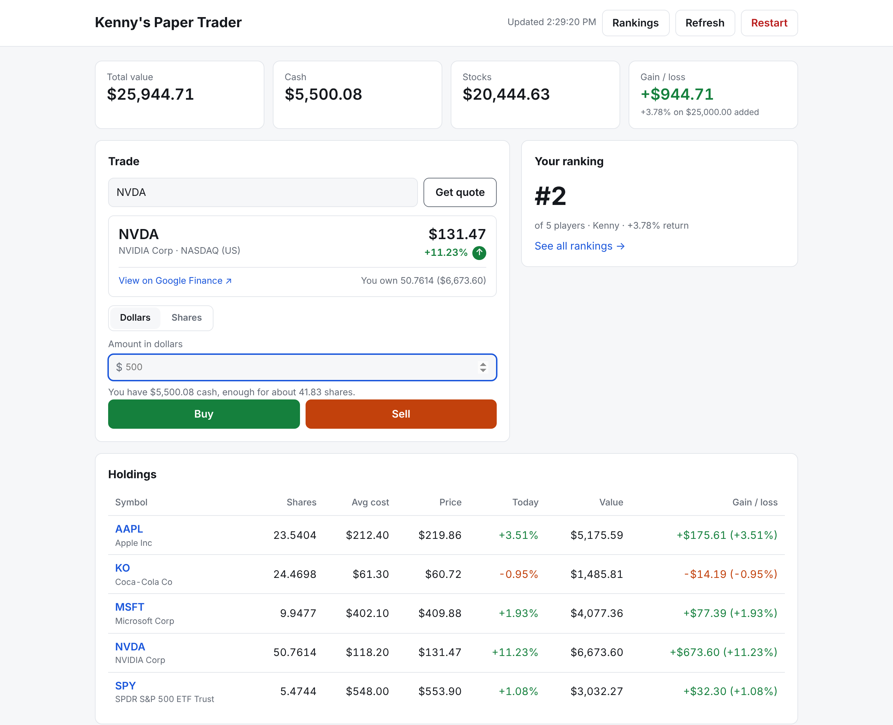

<div align="center">

# 📈 Kenny's Paper Trader

**Trade real stocks with fake money, and race your friends to the top of the leaderboard.**

Live prices. Zero risk. No sign-up.

### [▶ Play now at papertrader.kennk.workers.dev](https://papertrader.kennk.workers.dev/)



</div>

---

## Why you'll like it

Paper trading is the best way to learn the market without losing a cent. Kenny's Paper Trader keeps
it simple: type a name, pick how much pretend cash you want, and start buying real stocks at real
prices in under ten seconds.

- **⚡ Live market prices.** Type any US stock or ETF (`AAPL`, `NVDA`, `BRK.B`, `SPY`) and get the
  current price instantly. Your portfolio re-prices itself every 30 seconds.
- **💵 Start with any amount.** $1,000 or $1,000,000, it's your call. Trade in dollars or shares,
  fractional shares included.
- **🏆 Compete with friends.** A public leaderboard ranks every player by **percent return**, so
  someone who started with $5k can beat someone who started with $500k.
- **👀 Scout the competition.** Click any name on the leaderboard to see exactly what they're holding,
  in read-only mode.
- **📊 Know where you stand.** Total value, cash, average cost, today's move and gain/loss on every
  position, plus a full trade history.
- **🔗 One click to research.** Every ticker links straight to its Google Finance page.
- **🙅 No account, no password.** Your browser remembers your portfolio. A private link opens it on
  your phone or another computer.
- **🔄 Fresh start anytime.** Hit **Restart** to wipe the slate clean and try a new strategy.

## How to play

1. Open **[papertrader.kennk.workers.dev](https://papertrader.kennk.workers.dev/)**.
2. Enter a name for the rankings and your starting cash.
3. Type a symbol, check the quote, and hit **Buy**.
4. Watch the **Rankings** page and see how you stack up.

> Each game gets one starting deposit, so everyone plays by the same rules. Want more cash? Restart
> and pick a bigger number.

## Built to be fast and free

| | |
| --- | --- |
| **Runs on** | A single [Cloudflare Worker](https://developers.cloudflare.com/workers/) at the edge, close to every player |
| **Stores data in** | [Cloudflare D1](https://developers.cloudflare.com/d1/), so portfolios are still there when you come back |
| **Front end** | Plain HTML, CSS and JavaScript. No framework, no build step, loads instantly |
| **Prices from** | Google Finance quote pages, with Yahoo Finance as an automatic backup |
| **Costs** | $0. Everything fits in Cloudflare's free tier |

<details>
<summary><b>Where prices come from</b></summary>

Google Finance doesn't have an official API, so the Worker reads the live price from the public
Google Finance quote page (for example `https://www.google.com/finance/quote/AAPL:NASDAQ`). For a
bare symbol it tries the US exchanges (NASDAQ, NYSE, NYSE Arca, NYSE American, Cboe BZX) to find the
listing. If Google returns no price, it falls back to Yahoo Finance's free chart endpoint.

Quotes are cached for 15 seconds for display; trades always fetch a fresh price. Only US-dollar
listings are supported so cash stays in one currency. Prices may be delayed, and the money is
simulated.

</details>

---

## For developers

### Run it locally

Requires Node.js 18 or newer.

```sh
npm install
npm run dev      # http://localhost:8787, using a local D1 database
```

### Tests

```sh
npm test
```

The tests run the real Worker against a local D1 database with a fake Google Finance, so they need
no network connection or Cloudflare account.

### Deploy

The D1 database (`papertrader`) already exists and its id is in `wrangler.toml`.

- **From GitHub (recommended):** in the Cloudflare dashboard go to **Workers & Pages → Create →
  Import a repository**, pick this repo, and every push to `main` deploys. To use your own domain,
  add it under the Worker's **Settings → Domains & Routes**.
- **From your computer:** `npx wrangler login`, then `npm run deploy` (applies new migrations, then
  deploys).

Pointing at a fresh Cloudflare account? Run `npx wrangler d1 create papertrader` first and put the
printed id in `wrangler.toml`.

<details>
<summary><b>Admin page</b></summary>

`/admin.html` lists every player and lets you copy their private link, rename, reset or delete them.
It checks a key against its SHA-256 hash in the `settings` table, so the key itself is never
stored. To set or change it:

```sh
node -e "console.log(require('crypto').createHash('sha256').update(process.argv[1]).digest('hex'))" 'your-new-key'
npx wrangler d1 execute papertrader --remote --command \
  "INSERT OR REPLACE INTO settings (key, value) VALUES ('admin_key_sha256', '<hash from above>')"
```

</details>

<details>
<summary><b>API reference</b></summary>

| Method | Path | Body | |
| --- | --- | --- | --- |
| `GET` | `/api/quote?symbol=AAPL` | | Live quote (add `&fresh=1` to skip the 15s cache) |
| `POST` | `/api/portfolios` | `{ "name": "Kenny", "startingCash": 10000 }` | Create a portfolio, returns `{ id }` |
| `GET` | `/api/portfolios/:id` | | Cash, positions with live prices, history (`?fresh=1` skips the cache) |
| `POST` | `/api/portfolios/:id/deposit` | `{ "amount": 500 }` | Add starting cash (only when nothing has been added since the last reset) |
| `POST` | `/api/portfolios/:id/name` | `{ "name": "Kenny" }` | Set or change the player name |
| `GET` | `/api/players/:name` | | Read-only view of a player's portfolio (no portfolio id) |
| `GET` | `/api/leaderboard?me=:id` | | Public rankings; `me` marks your own row (ids are never returned) |
| `POST` | `/api/portfolios/:id/trade` | `{ "symbol": "AAPL", "side": "buy", "shares": 10 }` or `"dollars": 500` | Buy or sell at the current price |
| `POST` | `/api/portfolios/:id/reset` | | Set cash to $0 and erase holdings and history |
| `DELETE` | `/api/portfolios/:id` | | Delete the portfolio |

</details>

### Project layout

```
public/          the web pages (plain HTML, CSS and JavaScript)
src/index.js     the Worker: API routes and portfolio logic
src/quotes.js    Google Finance quotes, with the Yahoo Finance fallback
migrations/      D1 database schema
test/            tests (node --test)
docs/            README assets
```

## License

MIT
